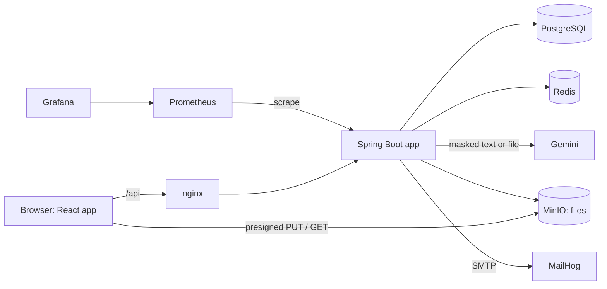
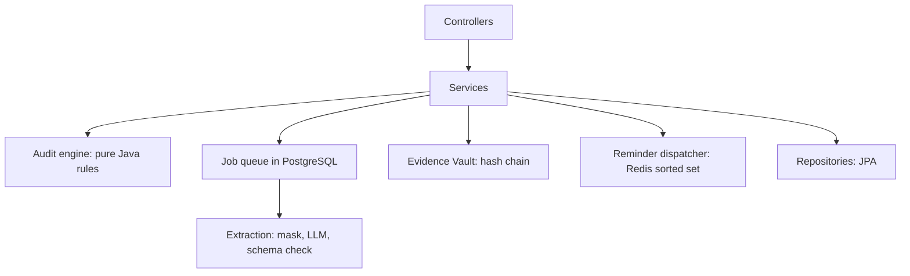

# FairExit

FairExit helps tenants in India get a fair security deposit back.

At move out, landlords often send a list of deductions (painting, cleaning, lift charges,
"maintenance") that the tenant cannot check. FairExit's **Deduction Audit** checks every line of
that bill against the rent agreement, wear and tear rules, move in photos and real repair prices,
then gives a verdict with a reason for each line and a ready to send reply.

**The AI only reads messy text. Java rules make every decision.**

> FairExit gives information, not legal advice.

## Quick start

Needs Docker Desktop. From a fresh clone, one command:

```bash
docker compose up --build
```

The first build takes a few minutes (Maven and npm download everything). Then open:

| What | URL |
|---|---|
| **The app** | http://localhost:8081 |
| API docs (Swagger UI) | http://localhost:8080/swagger-ui.html |
| Inbox for reminder emails (MailHog) | http://localhost:8025 |
| Grafana dashboard | http://localhost:3000 (folder "FairExit") |
| Prometheus | http://localhost:9090 |
| MinIO console (stored files) | http://localhost:9001 (user `fairexit`, password `fairexit-secret`) |

Everything works without any setup. Two optional settings in `.env` (copy `.env.example`):

* `GEMINI_API_KEY` turns on reading pasted messages, photos and agreements with Gemini. Without
  it, bills are typed in by hand and everything else works.
* `JWT_SECRET`: the default is for local use only. Set your own (`openssl rand -base64 48`)
  before running anywhere else.

To try the whole flow: create an account, add your home, upload the agreement and move in photos,
read the agreement's clauses, paste the landlord's bill, check and confirm the lines, link photos
to charges, run the audit, copy the reply, make the evidence pack, and record what you got back.

## The worked example

A 2BHK in Bengaluru, 24 months of tenancy, deposit ₹1,50,000. With the agreement, the electricity
bill, the tap photos and price data on file, the audit gives:

| Line | Amount | Verdict | Why (rule) |
|---|---|---|---|
| Full flat repainting | ₹55,000 | Questionable | Normal wear and tear after 24 months (R3) |
| Lift usage | ₹2,000 | Not in agreement | No clause allows it (R2) |
| Deep cleaning | ₹8,000 | Questionable | Above 9 in 10 real prices for a 2BHK in Bengaluru (R5) |
| Broken bathroom tap | ₹1,500 | Fair | Fine in move in photo, broken in move out photo, price in range (R6) |
| Pending electricity bill | ₹3,200 | Fair | Matches the bill on file (R1) |

₹65,000 of ₹69,700 is questionable. The polite reply agrees to ₹4,700 and asks for ₹1,45,300 back.
This exact result is checked by `WorkedExampleTest` (engine only) and by
`AgreementIntegrationTest` (through the whole API, with real PostgreSQL, Redis and MinIO).

## Architecture

One Spring Boot service (a layered monolith), PostgreSQL, Redis and S3 compatible storage.



Inside the app:



| Package | What it holds |
|---|---|
| `controller` | REST endpoints, nothing else |
| `service` | Use cases: tenancies, bills, audits, agreements, evidence, prices, replies, outcomes, accounts |
| `service.audit` | The rules engine: `AuditEngine`, one class per rule, `RuleSet`. No I/O at all |
| `service.llm` | `LlmClient` (Gemini behind an interface), masking, cache, daily limit, answer checks |
| `service.jobs` | The PostgreSQL job queue and its worker |
| `service.vault`, `service.storage` | Hash chain, verification, file type checks, MinIO access |
| `service.reminders`, `service.pack`, `service.prices`, `service.reply` | Reminders, evidence pack PDF, price stats, reply drafts |
| `repository`, `model`, `dto` | JPA repositories, entities, request and response records |
| `config` | Security, JWT, rate limit and idempotency filters, metrics, settings |
| `exception` | One global handler: every error is `{status, message, timestamp}` |

### How the main pieces work

**Audit engine.** Rules are rows in the `rules` table (id, version, state, type, parameters,
reason template), seeded by Flyway. Java has one class per rule type. For each line every rule
runs; the strongest verdict wins (NOT_IN_AGREEMENT, then QUESTIONABLE, then FAIR); if none fires,
R7 gives NEEDS_INFO with the question to ask the landlord. The engine is pure: the same input always
gives the same output, and every audit stores the rule versions it used. Karnataka and Kerala
have their own rules; other states use the general set and are labelled general guidance.

| Rule | Checks | Verdict |
|---|---|---|
| R1 | Utility charge matches a bill on file, or rent is 1 to 3 whole months | FAIR |
| R2 | Society or other charge with no agreement clause (only when an agreement is on file) | NOT_IN_AGREEMENT |
| R3 | Painting or cleaning after 11+ months, no clause making the tenant pay, no damage shown | QUESTIONABLE |
| R4 | A move in photo already shows the damage | QUESTIONABLE |
| R5 | Amount above the 90th percentile of 10+ real prices (same work, city, flat size) | QUESTIONABLE |
| R6 | Fine in move in photos, damaged in move out photos, price within the usual range | FAIR |
| R7 | Nothing above decides | NEEDS_INFO |

**AI extraction.** Pasting a bill saves it and queues a job in the same transaction. A worker
takes jobs with `SELECT ... FOR UPDATE SKIP LOCKED`, so several app instances never take the same
job. Before anything reaches Gemini, phone numbers, emails, PIN codes and the user's name are
masked. Answers must match a strict JSON shape with real positive amounts, or they are thrown away
and retried (3 tries, 5 and 20 seconds apart). Checked answers are cached by SHA-256 of the input,
and each user has 20 LLM calls a day. The tenant always confirms or edits the lines before an
audit. Agreement clauses are kept only when their quote is really in the agreement.

**Evidence Vault.** Files go from the browser straight to MinIO through 10 minute presigned URLs.
On "complete" the server reads the file, checks its real type from its first bytes, hashes it,
stores those exact bytes under a key no client can write to, and links the record into a hash
chain per tenancy (each record's hash covers the one before it). `GET /verify` recomputes
everything and names any changed file, edited row, removed record or wrong chain head.

**Reminders.** PostgreSQL holds them; a Redis sorted set scored by due time is the index the
dispatcher reads (rebuilt from PostgreSQL on every start). Each send takes a `SET NX` lock and ends
with `UPDATE ... SET status = 'SENT' WHERE status = 'PENDING'`, which only one caller can win. If
the app dies after the mail server took the email but before that update, the retry carries the
same fixed `Message-ID`, so the inbox still shows one email.

**API protection.** JWT access tokens (15 minutes) and refresh tokens (7 days, stored hashed in
Redis, one use each). A Redis token bucket, written as one Lua script, allows 60 requests a minute
per user (per IP before login). Every write accepts an `Idempotency-Key`: a repeat returns the first
response instead of doing the work twice.

## Data model

| Table | Holds |
|---|---|
| `users` | Email, BCrypt password hash, name, role |
| `tenancies` | City, state, flat size, rent, deposit, dates, notice days, hash chain head |
| `documents` | Vault files: type, phase, room, item, SHA-256, chain sequence, previous and record hash |
| `agreements`, `clauses` | Each reading of an agreement; clauses with page, exact quote and value |
| `deduction_bills`, `deduction_lines` | Bills (typed, pasted or photographed) and their lines |
| `line_evidence` | Photos the tenant linked to a line, with what they show |
| `rules` | Versioned audit rules per state |
| `audits`, `audit_verdicts` | Immutable audit results: totals, and per line verdict, rule ids, reason, evidence |
| `price_points`, `price_stats` | Real prices, and p50 and p90 per category, city and flat size (rebuilt nightly) |
| `reminders` | Notice, move out and refund reminders, with send status |
| `evidence_packs` | Stored PDFs with their hash and the vault check result |
| `outcomes` | Amount returned and days taken |
| `jobs` | The background job queue |

Every table that belongs to a user reaches `users` through `ON DELETE CASCADE`, so deleting an
account removes everything in one statement. The schema is built by the Flyway migrations in
`backend/src/main/resources/db/migration` (V1 to V8).

## API

Full, interactive docs: **http://localhost:8080/swagger-ui.html** (press "Authorize" and paste the
`accessToken` from login). Every endpoint except login, register, refresh and logout needs
`Authorization: Bearer <token>`. Errors always look like `{"status":404,"message":"Bill not found","timestamp":"..."}`.
Another user's data is always 404, never 403, so ids cannot be probed.

| Method | Path | What it does |
|---|---|---|
| POST | `/api/auth/register` | Create an account |
| POST | `/api/auth/login` | Access token (15 min) and refresh token (7 days) |
| POST | `/api/auth/refresh` | New pair for a refresh token; the old one stops working |
| POST | `/api/auth/logout` | Revoke a refresh token |
| GET | `/api/users/me` | The logged in user |
| DELETE | `/api/users/me` | Delete the account, its data and files (`{"password":"..."}`) |
| POST | `/api/tenancies` | Add a home |
| GET | `/api/tenancies` | Your homes, newest first |
| GET | `/api/tenancies/{id}` | One home |
| POST | `/api/tenancies/{id}/uploads` | Presigned URL to upload one JPG, PNG or PDF (10 MB max) |
| POST | `/api/tenancies/{id}/uploads/{docId}/complete` | Check, hash and chain the uploaded file |
| GET | `/api/tenancies/{id}/documents` | Stored documents with their hashes |
| GET | `/api/documents/{id}/download` | 10 minute download link |
| GET | `/api/tenancies/{id}/verify` | Re-hash every file and walk the chain |
| POST | `/api/tenancies/{id}/agreement` | Read a stored agreement's clauses (202, background) |
| GET | `/api/tenancies/{id}/agreement` | The latest agreement and its clauses |
| POST | `/api/tenancies/{id}/bills` | Add a bill: `lines` (201), pasted `text` or a `documentId` (202, read by the AI) |
| GET | `/api/tenancies/{id}/bills` | A home's bills with their latest audit |
| GET | `/api/bills/{id}` | A bill and its lines (poll while `EXTRACTING`) |
| PUT | `/api/bills/{id}/lines` | Confirm, edit, delete or add lines |
| PUT | `/api/bills/{id}/lines/{lineId}/evidence` | Link move in and move out photos to a line |
| GET | `/api/bills/{id}/lines/{lineId}/evidence` | A line's linked photos |
| POST | `/api/bills/{id}/audit` | Run the Deduction Audit |
| GET | `/api/audits/{id}` | A stored audit |
| GET | `/api/audits/{id}/replies` | Polite and firm replies, amounts taken only from the audit |
| POST | `/api/audits/{id}/evidence-pack` | Build the evidence pack PDF; link valid 7 days |
| POST | `/api/tenancies/{id}/reminders` | Plan notice, move out and refund reminders |
| GET | `/api/tenancies/{id}/reminders` | Planned and sent reminders |
| POST | `/api/tenancies/{id}/outcome` | Record what was returned (stops pending reminders) |
| GET | `/api/tenancies/{id}/outcome` | The recorded outcome |
| POST | `/api/admin/price-points` | Admin: import prices as CSV (`text/csv`), all or nothing |
| POST | `/api/admin/price-stats/refresh` | Admin: rebuild price ranges now (also nightly at 02:30 IST) |

Example: audit a typed bill.

```bash
TOKEN=...   # accessToken from /api/auth/login
curl -s -X POST localhost:8080/api/tenancies/$TENANCY/bills \
  -H "Authorization: Bearer $TOKEN" -H 'Content-Type: application/json' \
  -d '{"lines":[{"item":"Full flat repainting","category":"PAINTING","amount":55000},
               {"item":"Lift usage","category":"SOCIETY_CHARGE","amount":2000}]}'
curl -s -X POST localhost:8080/api/bills/$BILL/audit -H "Authorization: Bearer $TOKEN"
```

Price CSV format (admins are the accounts listed in `ADMIN_EMAILS`):

```csv
category,city,flat_size,amount
CLEANING,Bengaluru,TWO_BHK,4500
REPAIR,Bengaluru,TWO_BHK,1200
```

## Running parts on their own

**Backend from your IDE** (Java 17, Maven 3.9): start only what it needs, then run the app.

```bash
docker compose up -d postgres redis minio mailhog
cd backend && JWT_SECRET=local-development-only-secret-change-me-0123456789 mvn spring-boot:run
```

**Frontend with live reload** (Node 20+): Vite forwards `/api` to port 8080.

```bash
cd frontend && npm install && npm run dev     # http://localhost:5173
```

## Tests

```bash
cd backend && mvn verify      # needs Docker running, for Testcontainers
```

* Unit tests (JUnit 5, Mockito) for every rule, the engine, the worked example, masking, the
  LLM answer checks, the hash chain, the PDF, reminders planning and more. No Docker needed.
* Integration tests with Testcontainers start real PostgreSQL 16, Redis 7 and MinIO, and drive the
  API through the full filter chain. The LLM and the mail server are mocks.
* `mvn verify` fails if line coverage is below 70% overall or below 80% for the audit engine
  (JaCoCo). Report: `backend/target/site/jacoco/index.html`.
* CI (GitHub Actions) runs all of this on every push and pull request.

## Monitoring and load test

Grafana's FairExit dashboard shows audit p95, HTTP p95 per endpoint, requests by status,
extraction failures, job and reminder queues, LLM calls and tokens per day, and 429s.

The k6 test runs the worked example's audit at 100 requests per second for a minute:

```bash
# in .env: RATE_LIMIT_CAPACITY=1000000, so k6 measures the app, not the rate limiter
docker compose up -d --build
docker compose --profile loadtest run --rm k6
```

k6 prints p50, p95 and p99 per request type and fails if the audit p95 is 300 ms or more. In
GitHub Actions, "Run workflow" on the CI workflow runs the same test.

## Configuration

All settings have local defaults; override them in `.env`.

| Variable | Default | What it does |
|---|---|---|
| `JWT_SECRET` | a local only key | Signs access tokens; at least 32 characters |
| `GEMINI_API_KEY` | empty | Turns on AI reading; empty means manual entry only |
| `GEMINI_MODEL` | `gemini-3.8-flash` | Any Gemini model with JSON output |
| `DB_NAME`, `DB_USER`, `DB_PASSWORD` | `fairexit` | PostgreSQL |
| `MINIO_ROOT_USER`, `MINIO_ROOT_PASSWORD` | `fairexit`, `fairexit-secret` | MinIO (password 8+ characters) |
| `ADMIN_EMAILS` | empty | Accounts that may import prices |
| `RATE_LIMIT_CAPACITY` | `60` | Requests per minute per user; raise only for load tests |
| `CORS_ALLOWED_ORIGINS` | `http://localhost:5173,http://localhost:8081` | Browser origins allowed to call port 8080 |
| `GRAFANA_ADMIN_PASSWORD` | `admin` | Grafana login |

## Security and privacy

* Passwords hashed with BCrypt; login takes the same time whether or not the email exists.
* Every query is scoped to the logged in user; another user's ids return 404.
* Refresh tokens are stored only as SHA-256 hashes, rotate on every use, and are all revoked when
  the account is deleted.
* Personal details are masked before any text is stored or sent to the LLM. Photos and scanned
  PDFs cannot be masked and are sent as they are.
* Vault files cannot be changed without `verify` (and every evidence pack) showing it.
* Deleting an account removes every row, every file (through a retried job) and every token.

## Limits and future work

Not built in version 1, by choice:

* **Scaling path:** move extraction jobs to Kafka with partitions by user; PostgreSQL read
  replicas; split the price service out; shard price data by city. Today one instance with the
  PostgreSQL job queue is enough.
* **Building Deposit Score (F13), Telegram bot (F14), landlord badge (F15):** out of scope.
* **Cloud deployment:** everything runs locally; MinIO and MailHog swap for R2 or S3 and a real
  email provider by changing settings.
* **Hardening for production:** httpOnly cookie for tokens instead of `localStorage`; anchoring the
  vault's chain head outside the database; encryption at rest for files; `/actuator/prometheus` on
  a separate, non public port; a dependency scan in CI.

## Project layout

```
backend/              Spring Boot app (Java 17, Maven)
  src/main/java/com/sankalp/fairexit/
  src/main/resources/db/migration/   Flyway migrations V1 to V8
  src/test/java/                     Unit and Testcontainers tests
frontend/             React and Vite app, served by nginx in Docker
monitoring/           Prometheus config, Grafana datasource and dashboard
load-test/            k6 script
docker-compose.yml    The whole stack
.github/workflows/    CI
```
